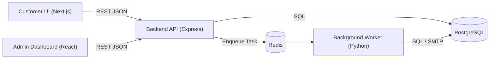

# System Architecture (Monorepo Example)

## Boundaries & Communication

- **Frontend & Admin** never connect directly to PostgreSQL; all mutations flow through `backend/`.
- **Shared DTOs** live in `shared/` and are imported by `frontend/`, `admin/`, and `backend/`.
- **Worker** consumes jobs queued by `backend/` via Redis (defined in `docker-compose.yml`).
