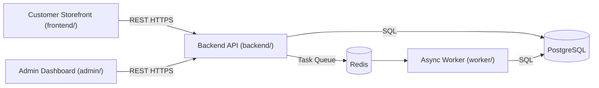

# Worked Example: Full-Stack Monorepo (Scenario 2)

Demonstrates strict separation across `frontend/`, `admin/`, `backend/`, `worker/`, `shared/`, and `docker-compose.yml`.

## Generated Documentation Tree

```text
commerce-platform/
├── README.md                              # Compact index + app table ONLY
├── docker-compose.yml
└── docs/
    ├── architecture.md                    # System boundaries + Mermaid communication diagram
    ├── deployment.md                      # Docker Compose & CI pipeline
    └── projects/
        ├── frontend/
        │   ├── README.md                  # Next.js storefront install, dev, structure
        │   └── development.md
        ├── admin/
        │   └── README.md                  # React admin dashboard setup & structure
        ├── backend/
        │   ├── README.md                  # Express/Nest API setup
        │   ├── api.md
        │   ├── database.md
        │   └── authentication.md
        ├── worker/
        │   ├── README.md                  # Python Celery background jobs
        │   └── workflows.md
        └── shared/
            └── README.md                  # Shared TS types & validation schemas
```

## Excerpt: `docs/architecture.md` Communication Flow


