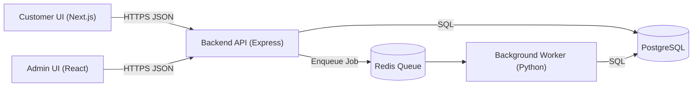

# Architecture Documentation Guide

Document how the pieces fit together at a system level without duplicating component internals.

## When to Create `architecture.md`

- Create `docs/architecture.md` for multi-service apps, monorepos, or single applications with nontrivial subsystems (API + DB + background jobs + external third-party APIs).
- Skip a separate `architecture.md` for tiny single-purpose scripts or simple static sites where 1 concise section in `README.md` suffices.
- For **multiple unrelated projects** in one workspace, never fabricate a unified architecture—keep boundaries cleanly isolated.

---

## What `architecture.md` Must Cover

1. **System Overview & Application Boundaries:** What each app/service owns and what it explicitly does **not** own.
2. **Communication & Data Flow:** How apps talk (REST/GraphQL HTTP, gRPC, WebSockets, message queues like Redis/BullMQ/RabbitMQ/SQS, shared database access, webhooks).
3. **Primary Request Lifecycle:** Trace 1–2 concrete core flows (e.g., *Customer checkout request* or *Async background report generation*) from client action -> gateway/API -> DB/queue -> worker -> response/callback.
4. **Shared Packages & Contracts:** Shared TypeScript types, UI kits, validation schemas (`packages/shared/`), and how apps consume them.
5. **External Integrations:** Third-party APIs (Stripe, Auth0, S3, email provider, LLM APIs) with link to where client wrappers live in code.

---

## Mermaid Best Practices

Keep diagrams focused (under ~12 nodes) and quote labels with punctuation or parentheses:

Only include nodes and connections verified in the repository's config, compose files, and source code.
