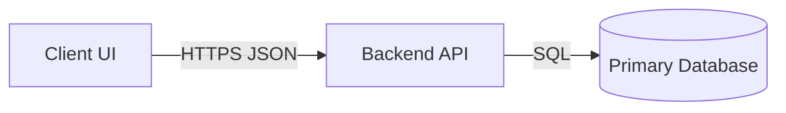

# System Architecture

<Brief overview of the system topology and design boundaries.>

## System Diagram

## Application Boundaries

| Component | Owns | Does Not Own |
|---|---|---|
| `<Component A>` | `<Responsibilities>` | `<Explicit boundary>` |
| `<Component B>` | `<Responsibilities>` | `<Explicit boundary>` |

## Service Communication & Request Flow

1. `<Client request enters gateway/API>`
2. `<Auth & validation>`
3. `<DB persistence / queue publish / worker execution>`

## Shared Packages & Dependencies

- `<packages/shared>` — `<Types, validation schemas, UI primitives>`

## External Integrations

- `<Provider Name>` — `<Purpose + link to client wrapper file>`
